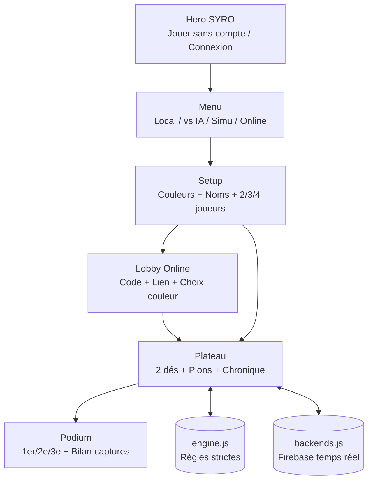

# 🎲 SYRO GAMES — Le Ludo en ligne à 2, 3 ou 4 joueurs

## ▶ Joue direct : https://yriexdejesuse-sketch.github.io/ludo/

Ouvre le lien : l'onglet affiche **SYRO GAMES (v2026-11-16)**.
Si tu vois une ancienne version, fais **Ctrl+Maj+R**.

Jeu complet : **local 2/3/4 joueurs** (même écran), **vs ordinateur**, **en ligne** avec un code/lien. Thème SYRO clair/sombre, plateau qui pivote.

## 🎮 Jouer en ligne

1. **Toi** : Créer une partie en ligne → couleur + pseudo → Lancer → **code** `5AU2H` + **lien** `?room=CODE`
2. **Ton ami** : ouvre ton lien → lobby
3. **Toi (hôte)** : **▶ Lancer la partie** — rien ne démarre tout seul

Temps réel (Firestore), lien nettoyé à la sortie, plateau orienté sur ta couleur.

## Contenu

```
ludo/
├── server.js                 # serveur local (optionnel)
├── README.md                 # ce fichier (public)
├── DOCUMENTATION.md          # historique complet du projet (tracé dev)
├── MISE_EN_LIGNE.md          # guide déploiement
├── test.js                   # tests moteur (20 tests)
└── public/                   # site (servi par GitHub Pages)
    ├── index.html            # SYRO GAMES v2026-11-16
    ├── style.css             # thème SYRO
    ├── app.js                # interface + sons + IA
    ├── engine.js             # moteur de règles
    ├── backends.js           # online Firebase / serveur
    └── firebase-config.js    # projet ludo-yriex-zbv338
```

## Lancer en local

```bash
node server.js  # http://localhost:3000
```

## 🌐 Mise en ligne — déjà fait

| | État |
|---|---|
| **Site** | GitHub Pages branche `gh-pages` → URL ci-dessus |
| **Base** | Firebase Firestore `ludo-yriex-zbv338` |
| **Config** | `firebase-config.js` déjà rempli |

Voir `MISE_EN_LIGNE.md` pour refaire une mise en ligne.

## 📜 Règles v2026-11-16

- **2 dés** : chaque dé = 1 déplacement (même pion ou 2 pions). Choix auto si évident, menu si plusieurs coups. Zéro-clic si 1 seul pion sans choix.
- **Sortie** : **6 direct** (pas 4+2). Double 6 = relance, triple = tour perdu.
- **Étoiles ⭐ + départs ⭘ = protégés 100%** : on s'y empile, jamais mangé (même recul/somme).
- **Recul = uniquement pour manger** (anneau + couloir 51-55).
- **Même pion ne mixe pas** : pas d'avancer puis reculer avec le même pion dans le même tour. 2 pions différents OK.
- **5 dernières cases (51-55)** : mangent en avant ET en arrière (vers couloir ou anneau).
- **56 = maison finale intouchable**.
- **Capture stricte** : manger avec un dé exige un autre pion pour l'autre dé. Somme = uniquement pour capturer.
- Partie continue tant que 2 joueurs non classés. Bilan : plus violent / plus violenté.

### Détail des règles avec exemples

| Situation | Ce qui se passe | Exemple |
|---|---|---|
| **Sortir de base** | Il faut un **6** sur un dé. Tu peux enchaîner l'autre dé sur le pion sorti. | Tu fais 6+2 → sors en 0 puis avance de 2 |
| **Double 6** | Tu rejoues. **3 double-6 de suite = tour perdu** | 6+6 → relance, encore 6+6 → relance, encore 6+6 → perdu |
| **Étoile ⭐** | Case coffre-fort : 2 pions dessus = côte à côte, **personne n'est mangé** | Rouge sur étoile, Bleu fait 1 → s'empile, ne mange pas |
| **Manger en reculant** | Si l'adversaire est à 3 derrière toi et tu fais 3 → tu recules et le manges | Rouge en 20, Jaune en 17, tu fais 3 → recul + capture |
| **Somme 3+2=5** | Uniquement pour manger (recul ou entrée couloir), jamais pour sortir | 1 pion seul + 4+2=6 → pas de sortie, tour passe |
| **Même pion qui mixe** | Interdit : avance avec dé 1 puis recule avec dé 2 sur **même pion** → bloqué | Pion A avance de 2, même pion A veut reculer de 3 → refusé |
| **5 dernières cases** | En 51, 52, 53, 54, 55 tu peux manger **devant ET derrière** | En 53, ennemi en 51 (couloir) ou en 50 (anneau) → tu peux reculer de 2 ou 3 pour manger |

## 🗺️ Schéma du jeu



> `engine.js` ne touche jamais au DOM — `app.js` ne contient jamais de règle — c'est ce qui rend le jeu testable (20 tests en 0,4s).

## 🎬 Vidéo démo

**30s pour comprendre :**

[](https://yriexdejesuse-sketch.github.io/ludo/)

> 🎥 *Vidéo à venir : partie à 3 en ligne (Rouge vs Jaune vs Bleu) — sortie au 6, capture en recul, empilement sur étoile, victoire + bilan.*
> En attendant : lance une partie locale à 3 pour voir le plateau pivoter sur chaque couleur.

### Aperçu

```
[ SYRO GAMES Header + Hero badges live ]
[ 🎲 Jouer sans compte ] → [ Menu 5 modes ] → [ Setup 3 joueurs ] → [ Plateau SVG 600x600 + 2 dés + Panel ]
                                                    ↓
                                          [ Tour : Rouge joue + Chronique + Bilan ]
```
